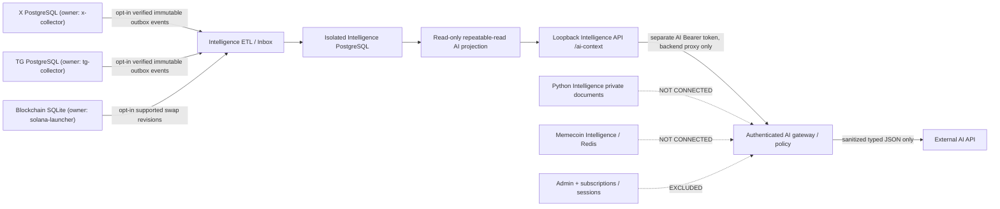

# AI data access architecture — separate, governed read model (ARCH-AI-01)

Status: **draft implementation in a dependent PR**, built on the Sprint 1
canonical-token/source-evidence work in PR #165. All deployment switches are
**OFF**. No source databases or AI provider have been connected live.

## Objective and hard boundaries

The future AI service consumes a **versioned, explicit server-to-server API**.
It must NOT receive credentials for any native collector database, perform
arbitrary SQL, inspect raw social content, acquire signing/trading keys, or
treat model output as a confirmed trade/signal.

This is a **logical** dataflow; the dotted paths are explicitly **not**
implemented connectors. No user query authorizes scanning every DB.

## Physical databases and authoritative ownership

| Domain | Physical owner/storage | Allowed through AI API now | Not allowed / missing |
| --- | --- | --- | --- |
| X | `x-collector`, independent PostgreSQL | Sample counts of independently verified, active mint links via Intelligence | Raw tweet body, handles, cookies, private profiles, direct X DB connection; production opt-in not verified |
| Telegram | `tg-collector`, independent PostgreSQL | Sample counts of independent active verified links, respecting edit/delete | Raw messages, private peer/member IDs, TG session, direct TG DB connection; history incomplete |
| Blockchain | `solana-launcher`, separate SQLite | Sample count of reconciled supported provider-parsed swap revisions | Raw wallet keys, direct trade DB, finalized on-chain trade or PnL inference |
| Node Intelligence | Separate PostgreSQL (001–005) | Versioned as-of numeric feature snapshot, bounded evidence and legacy timeline category counts | Unbounded SELECT, raw JSONB payloads, intermediate source proofs, SQL generated by model |
| Python Intelligence | Different Python runtime and document/jobs store | **Excluded** | No automatic document or user-message RAG; needs future classification, separate consent and governance |
| Memecoin Intelligence | Separate PostgreSQL + Redis | **Excluded** | No direct access; independent quality/ownership review needed |
| Admin / subscriptions / MiniApp | Separate product/control databases | **Excluded** | Authentication records, billing, sessions, audit details and feature flags are never model context |

*Existing domain inventory:* `docs/architecture/DATA_CONTRACTS.md`.
The runtime readiness of a source cannot be inferred from the presence of its
SQL table, outbox flag, or any CI fixture.

## API contract (opt-in, data-only)

**Read model**: `GET /api/intelligence/v1/tokens/:id/ai-context`
with required `occurredBefore` and `knownAt` (UTC ISO 8601), optional
`limit` (1–100; internally at most 50 rows **per evidence category**).

**Schema catalog**: `GET /api/intelligence/v1/ai/catalog` returns only the
*declared contract* of sources and exclusions; not live discovery.

A separate `INTELLIGENCE_AI_API_TOKEN` must be explicitly configured together
with `INTELLIGENCE_AI_API_ENABLED=true` and the existing
`INTELLIGENCE_API_ENABLED=true`. The AI secret MUST differ from the ordinary
`INTELLIGENCE_API_TOKEN`. AI key is only valid for AI routes; existing key
cannot read AI routes. The service remains loopback-only; the future AI
gateway uses backend-to-backend access over a trusted boundary with its own
principal-level authorization, traffic controls and audit. **Never place
these tokens in a browser, LLM prompt, model output or external AI provider
config.** Transmit only sanitized response JSON to the model.

At startup the AI option requires migrations 001, 002, **003**, 004 and 005
in the **destination**, plus a least-privileged SELECT-only PostgreSQL role.
Feature schema 003 is **not** globally required for the ordinary API when
AI is off. No source DB schema is modified.

### Response sections

- `tokenId` is a verified-format **canonical identity**, not an independent
  claim that all mint history is observed or that a mint is tradable.
- `asOf` carries both occurred and knowledge cutoffs.
- `evidence.verifiedSocialLinks`: X/TG counts from a **bounded sample**
  of active, source-verified observations, not raw text. Edit/delete
  tombstones are applied by Intelligence.
- `evidence.blockchainSwapRevisions`: bounded count of current supported,
  cross-wallet-reconciled provider-parsed swaps. No finality or PnL.
- `evidence.legacyTimeline`: **separate** bounded sample counts with a
  disclaimer that the legacy timeline is *not* the verified token-link index.
- `featureSnapshot`: latest valid `features-v1` object with
  `as_of <= occurredBefore`, `max_input_observed_at <= knownAt`, and
  `computed_at <= knownAt`. The record is validated against the immutable
  field registry. Only typed numeric/timestamp values reach the AI; arbitrary
  `decoder_coverage` and `history_coverage` text is suppressed to prevent
  prompt injection/data leakage.
- Missing eligible feature snapshot returns `status: missing`,
  `values: null`, **never zero**. The API does not calculate features,
  predictions, recommendations, or success probabilities.
- Every category reports an independent sample cap and truncation. A
  bounded sample count is not a whole-dataset count, and an empty sample does
  not prove a source or wallet had zero activity.
- `historicalCompleteness: unknown`, `sourceCollectorLiveness: not_checked`
  and `missingDataPolicy: missing_does_not_mean_zero` must be preserved
  by any LLM consuming this output.

The feature snapshot's `data_confidence` is **stored source input**, not an
externally calibrated confidence interval. Reject requests for synthetic
PnL, quantified edge, investment signals or private actor identities.

## Data integrity and temporal model

1. Source records/outbox event commit together in each **native** database.
2. Claim/lease and ACK happen only in the owning source store.
3. Intelligence destination writes are atomic; destination COMMIT precedes
   source ACK. Replay is at-least-once and idempotent.
4. TG/X mint associations require literal mention, RPC SPL-mint account proof,
   revision hashes and explicit retractions; IDs use `solana:<full mint>`.
5. Blockchain observations are separate provider-parsed swap revisions, not
   a second social link, not chain-finality attestation.
6. AI read queries run inside **one PostgreSQL REPEATABLE READ READ ONLY**
   transaction, avoiding mixed snapshots during concurrent ETL commits.
7. Historical views require both **event occurrence** and **knowledge** time.
   The feature store adds a third `computed_at` availability gate. Future
   computed snapshots cannot leak into earlier model inputs/backtests.
8. API output intentionally contains no event keys, social handles, evidence
   source IDs, wallet addresses, raw timeline payloads, source free-text
   feature labels, SQL strings or connection details.
9. Credential scopes are disjoint. Ordinary Intelligence v1 Bearer cannot
   call `ai-context`, and AI Bearer cannot call `/health`, `/links` or
   other regular routes.

## Future stages — **not implemented by this PR**

- Source-local classification and consent/retention policy for any proposed
  Python document or research ingestion. Do not federate sensitive content
  just because it has a physical database.
- Separate data-quality and source-watermark **materialization** into the
  destination, with freshness/lag/coverage reason codes; never query native
  stores on each LLM request.
- Per-source/type lineage with parser version and provenance hashes kept in
  a private internal audit channel. Expose only anonymized safe summaries.
- Feature producer automation and provenance for each metrics field. Current
  003 stores immutable snapshots but does not prove continuous computation.
- Explicit source-by-source quality thresholds, missingness tests, benchmark
  datasets and drift evaluations for the external model.
- Independent API gateway audit log, scoped quotas per AI principal, egress
  controls, consent gates, incident procedures, data retention and model
  output validation before any automated action.
- Backup/restore drill for each physical store and confirmation of migrations,
  worker restarts, queue lag and DLQ before expanding live data.

## Verification gates

CI must pass `contracts`, `registry`, `intelligence-tests` plus native
TG/X tests on the *latest head*. The new `ai-context.test.mjs` covers:
separate API authentication, default-off behavior, catalog exposure,
single-snapshot transaction, independently bounded evidence, no raw data,
missing-feature semantics, future-computed feature exclusion in **disposable
PostgreSQL**, safe errors and rollback. CI is not a production source trial.

**Production activation gate:** owner-approved source and model provider
access; source DB backups/restores; least-privilege DB role; loopback gateway
deployment with independent principal authorization; strict egress privacy
review; bounded canary; real data quality/freshness; replay and rollback
drills. Until then the AI API is **offline tested only**.
