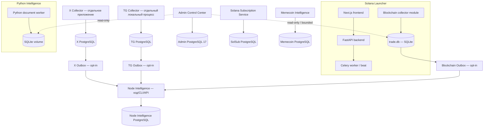

# Архитектура Claude Project — фактическое состояние (As-Is)

> Снимок исходников: `6273d9fb9f2f987c4ee7932cea0e10f77129f7d9`  
> Дата аудита: 2026-11-01  
> PR: [#212](https://github.com/vyborovamaria3-maker/claude-project/pull/212), Draft, открыт, не слит.  
> Основа сравнения: `main` = `f4dc5ef3aad400f64fc300f30542085e10aae4c1`; интеграционная ветка на 162 коммита впереди и 0 позади.  
> Это аудит исходников и CI-конфигураций. Это **не** подтверждение наличия production-серверов, действующих баз, внешних учётных записей или работающего production deployment.

## 1. Как читать статусы

- **В коде** — реализация обнаружена в указанной ревизии.
- **Offline/CI tested** — есть изолированные автоматические тесты; они не доказывают live-работу.
- **Compose configured** — сервис описан в Compose; это не доказывает, что Compose запущен.
- **Live NOT VERIFIED** — нет подтверждённого runtime-доступа и эксплуатационного свидетельства.
- **Target** — целевое архитектурное решение, а не факт текущей реализации.

## 2. Репозиторий

На проверяемой ревизии 18 каталогов верхнего уровня:

`.agents`, `.github`, `admin-site`, `cockpit-tools`, `docs`, `intelligence`, `mcp-servers`, `memecoin-intelligence`, `packages`, `pumpfun-chart`, `scripts`, `security`, `solana-launcher`, `solana-subscription-service`, `telegram-miniapp`, `tg-collector`, `work`, `x-collector`.

Это monorepo, но не единый runtime и не один npm workspace. У отдельных приложений собственные package manifests, lock-файлы, сборки и жизненные циклы.

## 3. Фактический контекст систем



Схема показывает логические связи из кода и конфигураций. Стрелки Outbox не означают, что live producers включены: source flags по умолчанию выключены, а Node Intelligence не представлен как постоянно запущенный production-сервис в текущих Compose.

## 4. Сервисы и фактические границы

### 4.1 Solana Launcher — `solana-launcher/`

**Текущий основной продукт.**

- Frontend: корневой `package.json` и `package-lock.json` фиксируют Next.js **16.4.2**, React **18.3.1**.
- Production frontend image собирается корневым `Dockerfile.frontend.prod`, а не `solana-launcher/frontend/Dockerfile`.
- Backend: FastAPI, SQLAlchemy, Alembic; Dockerfile использует Python 3.11.
- Background work: Celery, Redis, RabbitMQ.
- Compose: PostgreSQL 16, Redis 7, RabbitMQ 3, backend, Celery worker/beat, Twitter discovery, optional Telegram monitor, frontend, Nginx, Prometheus.
- Production Compose монтирует `./data:/app/data` в frontend-контейнер. Backup script ожидает `/app/data/trade.db`.

**Runtime finding:** `Dockerfile.frontend.prod` использует `node:20-bookworm-slim`, тогда как Frontend Quality CI использует Node 22. Node 20 достиг EOL 2026-04-30. Это реальная задача выравнивания и обновления production build/runtime. Официальный график: https://github.com/nodejs/Release#release-schedule.

Отдельный каталог `solana-launcher/frontend/` — старый пакет `ai-reply-guy-frontend`: Next.js 14.0.4 / React 18.2, его Dockerfile использует Node 18. В текущем production Compose он не указан как build context или Dockerfile. До доказательства обратного считать его legacy/orphaned frontend, а не основным Launcher frontend.

### 4.2 Blockchain Collector — модуль внутри Solana Launcher

- Исходники: `solana-launcher/scripts/blockchain-*.cjs` и связанные модули.
- Хранилище: SQLite `trade.db`.
- В production Compose файл находится в bind mount `./data:/app/data`, доступен frontend-контейнеру как `/app/data/trade.db`.
- WAL-aware backup выполняется через better-sqlite3 Online Backup API.
- Outbox и verified swap revision producers реализованы, opt-in.
- CI использует синтетические SQLite/WAL fixtures и изолированное восстановление.

**Архитектурный статус:** это логически выделенный Solana evidence/collection module, но **не отдельный независимо развёртываемый сервис**. Он физически и операционно связан с Solana Launcher. Называть его равноправным отдельным runtime с X/TG Collector нельзя. Выделение в отдельный сервис не выполнено и не должно подразумеваться в As-Is.

### 4.3 X Collector — `x-collector/`

- Node.js / TypeScript, PostgreSQL, Playwright/Chromium.
- `package.json` заявляет `engines.node >=20`; Dockerfile и X Collector CI фактически используют Node 22.
- X Collector CI использует PostgreSQL 16.
- Основные runtime-компоненты: scheduler, worker, PostgreSQL task queue, account/session handling, collector persistence, archive, analytics, graph, dashboard.
- Reply automation находится в `scripts/reply/*`; `compose.reply.yml` описывает API, supervisor, worker, scheduler, dashboard и PostgreSQL 16.

**Reply Guy** — внутреннее/историческое имя reply-подсистемы и старого frontend-пакета, а не самостоятельный верхнеуровневый продукт. Старый `solana-launcher/frontend` не следует путать с текущим корневым Next.js приложением.

### 4.4 TG Collector — `tg-collector/`

- Node.js / TypeScript, GramJS/MTProto, PostgreSQL.
- README и CI используют Node 22; в `package.json` поле `engines` не задано.
- README описывает локальный процесс на компьютере пользователя с внешней/локальной PostgreSQL.
- В репозитории нет отдельного TG Collector Dockerfile/Compose service.
- CI использует PostgreSQL 16 и проверяет миграции, тесты, backup/restore на disposable базе.
- Next.js integration routes внутри Solana Launcher — интерфейс к собственной TG DB, а не доказательство, что Node Intelligence timeline заполнен.

### 4.5 Node Intelligence — Node runtime в `intelligence/`

- `intelligence/package.json` заявляет Node `>=22`.
- В коде есть contracts integration, Inbox, Entity Registry, Evidence, Timeline, features, correlations, alerts, validation, backtest, AI analysis, ETL CLI/supervisor и API.
- Целевая БД — отдельный PostgreSQL; CI использует disposable PostgreSQL 16.
- Source producers X/TG/Blockchain передают события через opt-in outboxes.
- Сквозной CI использует mocked RPC/fixtures и изолированную БД.

**Deployment finding:** в текущих проверенных Compose нет отдельного Node Intelligence runtime service. Наличие Node CLI/API/supervisor в исходниках не доказывает его непрерывную production-работу. Его нужно считать реализованным кодом с offline/CI evidence, но live/continuous deployment — NOT VERIFIED.

### 4.6 Python Intelligence — отдельный Python runtime в том же каталоге

Node Intelligence и Python Intelligence — разные системы, несмотря на общий каталог `intelligence/`.

- Python 3.12 worker реализован в `intelligence/`; `intelligence/Dockerfile` строит именно Python runtime, а не Node Intelligence.
- Admin Compose запускает `intelligence-worker` с `POTAPOFF_INTELLIGENCE_DB=/var/lib/potapoff-intelligence/intelligence.sqlite3` и named volume `intelligence-state`.
- Admin монтирует SQLite volume read-only.
- В коде есть `SQLiteDocumentStore`, `PostgresDocumentStore` и `MemoryDocumentStore`.
- PostgreSQL backend описан как production-capable в storage README, но в текущем Admin Compose используется SQLite. PostgreSQL DSN/режим не подключён этим Compose.
- MemoryDocumentStore — in-memory backend для тестов/временных сценариев, не отдельная база и не durable storage.

### 4.7 Admin Control Center — `admin-site/`

- Python 3.12 / FastAPI.
- PostgreSQL 17 для административного состояния.
- Читает Python Intelligence SQLite и монтируемые данные источников в ограниченном режиме.
- Compose выставляет Admin на loopback `127.0.0.1:18080`.
- `ADMIN_PG_SCHEMA_MODE=preprovisioned` — opt-in. Текущий default legacy не равен фактическому переходу на runtime/migration separation.
- CI PostgreSQL 17 проверяет отдельную схему и DML-only runtime на disposable cluster; это не live role cutover.

### 4.8 Memecoin Intelligence — `memecoin-intelligence/`

- React/Vite frontend, Fastify API, workers, BullMQ.
- Compose: PostgreSQL 16, Redis 7.
- Собственная база и аналитическая модель. Не является Node Intelligence DB.

### 4.9 Solana Subscription Service — `solana-subscription-service/`

- npm workspaces: API, web, bot, shared.
- Root engine: Node >=22.
- Web: Next.js 16.4.2, manifest React ^18.3.1; lockfile содержит отдельный `apps/web/node_modules/react` 18.3.1, совместимый с peer range Next.js 16.
- Dockerfiles используют Node 22.
- Compose: PostgreSQL 16, Redis 7, Express API, Next.js web, Telegraf bot.
- Это самостоятельная система подписок; её нельзя автоматически считать уже единственным владельцем всех подписок в других приложениях.

### 4.10 Telegram MiniApp — `telegram-miniapp/`

Фактические подпроекты:
- `frontend/`: Vite + React 18.
- `bot/`: Node.js + `node-telegram-bot-api`.
- `backend-new/`: Node.js + Express + Prisma; текущий Prisma schema provider — **SQLite**.

В текущем дереве нет каталога `telegram-miniapp/backend/`. README, который описывает `backend/` с Python aiogram, устарел. `README-SOLANA-PAY.md` также заявляет PostgreSQL для backend-new, тогда как текущий Prisma schema указывает SQLite. Это документационное/конфигурационное расхождение; реальное использование и миграция данных не подтверждены. Старый README прямо называет часть платёжного flow mock/demo.

## 5. Версии и runtime matrix

| Компонент | Manifest / lock | CI / Docker / Compose | Вывод |
|---|---|---|---|
| Solana Launcher root web | Next 16.4.2, React 18.3.1; follow-up manifest engine >=22 | CI Node 22; follow-up production Docker Node 22 | React peer-compatible; EOL Node 20 image replaced in this PR follow-up |
| Solana Launcher legacy frontend | Next 14.0.4, React 18.2 | follow-up legacy Docker Node 22 | Не используется текущим production Compose; legacy Next 14 package, do not treat as current frontend |
| Solana Launcher backend | Python >=3.11 | Docker Python 3.11 | Совпадает |
| X Collector | follow-up engine >=22 | Docker/CI Node 22 | Manifest, lockfile, Docker and CI aligned on Node 22 |
| TG Collector | follow-up engine >=22 | README/CI Node 22 | Manifest and lockfile now declare Node 22 baseline |
| Node Intelligence | Node >=22 | CI Node 22; отдельного Node Compose service нет | Код/CI, live runtime не подтверждён |
| Python Intelligence | Python 3.12 | Docker Python 3.12 | Compose использует SQLite |
| Admin | Python 3.12 | Compose PG17 | Отдельная Admin DB |
| Memecoin Intelligence | Node runtime | Compose PG16 + Redis 7 | Отдельный stack |
| SolSub | Node >=22; Next 16.4.2 | Docker Node 22; PG16 + Redis 7 | Отдельный stack |
| TG MiniApp frontend | React 18 / Vite 5 | Отдельного production Compose нет | Demo/standalone subproject |

Next.js 16.4.2 в проверенных lock-файлах допускает React `^18.2.0` или React 19. Поэтому утверждение «Next.js 16 + React 18 несовместимы» для этой зафиксированной зависимости неверно. Проверять следует конкретные resolved versions и peerDependencies, а не общее правило «Next 15+ требует React 19».

## 6. Сетевой scope: Solana-only

**Целевая политика проекта: единственная поддерживаемая blockchain-сеть — Solana.** Новый canonical token ID: `solana:<full-base58-mint>`. X и Telegram — социальные источники evidence, а не blockchain networks.

При этом в текущем коде ещё обнаружены legacy multi-chain участки:
- `packages/contracts/src/canonical-ids.ts`: Ethereum/Base/Arbitrum в `CHAINS`, EVM normalizer и тесты.
- `packages/contracts/src/evidence.ts` и `intelligence/src/entity-registry.ts`: общие chain evidence validators, в том числе EVM.
- `x-collector/lib/intelligence/chain-adapter.ts`: Ethereum/Solana/Bitcoin; `scripts/chain-ingest.ts` импортирует локальный JSON, это не доказательство live RPC collectors.
- `solana-launcher/lib/kols/*` и backend KOL API: Ethereum wallet path.
- `tg-collector/src/analytics/*` и SQL migrations: извлечение/хранение `evm_address` как generic message reference; это не verified token evidence.
- TeraGram dataset/curator modules содержат EVM contract extraction.
- `solana-wallet-warmup` содержит cross-chain bridge stubs/configuration.

Эти участки не должны трактоваться как поддерживаемая мультичейн-архитектура. Их вывод — отдельная задача с тестами и additive migrations. Не удалять исторические EVM-строки и не переписывать applied SQL migrations автоматически. Сначала прекратить новые EVM writes, скрыть/пометить legacy данные, затем согласовать миграцию схемы и удаление compatibility code.

## 7. Владение данными и физические границы

| Хранилище | Логический владелец | Текущее размещение по коду/Compose | Статус |
|---|---|---|---|
| POTAPoff PostgreSQL 16 | Solana Launcher | Compose service `postgres` | Compose configured; live NOT VERIFIED |
| Blockchain `trade.db` SQLite WAL | Blockchain module внутри Solana Launcher | host `./data/trade.db` → frontend container `/app/data/trade.db` | Synthetic backup/restore tested; не отдельный сервис |
| X PostgreSQL | X Collector | Отдельная БД/Compose reply stack или внешняя локальная БД | CI PG16; physical live NOT VERIFIED |
| TG PostgreSQL | TG Collector | Внешняя/локальная БД пользователя | CI PG16; physical live NOT VERIFIED |
| Node Intelligence PostgreSQL | Node Intelligence | `INTELLIGENCE_DATABASE_URL`; отдельный production Compose не найден | Disposable CI only; live NOT VERIFIED |
| Python Intelligence SQLite | Python Intelligence | Admin Compose volume `intelligence-state` | Compose configured; central backup includes SQLite |
| Python Intelligence PostgreSQL | Python Intelligence code backend | Реализация есть, текущий Compose не подключает | Not current Compose backend |
| Admin PostgreSQL 17 | Admin | Compose service `admin-postgres` | Compose configured; live NOT VERIFIED |
| Memecoin PostgreSQL 16 / Redis 7 | Memecoin app | Собственный Compose | Compose configured; live NOT VERIFIED |
| SolSub PostgreSQL 16 / Redis 7 | SolSub | Собственный Compose | Compose configured; live NOT VERIFIED |
| Telegram MiniApp SQLite | MiniApp backend-new | Prisma datasource provider sqlite | Demo/standalone; live NOT VERIFIED |
| MemoryDocumentStore | Python Intelligence test/runtime adapter | RAM процесса | Не durable database |

Это логическая карта из репозитория. Она не является доказательством физического количества баз или volume на реальном сервере.

## 8. PostgreSQL roles и backup

В Product Compose `POSTGRES_USER=potapoff`, и backend/Celery/discovery используют ту же login identity. Central backup script также выполняет `pg_dump` как `potapoff`. В Admin Compose `POSTGRES_USER=potapoff_admin`, Admin DSN и backup используют `potapoff_admin`.

Целевые роли Bootstrap / Migration / Runtime / Backup описаны в `docs/operations/POSTGRES_ROLE_SEPARATION_PLAN.md`. Они **не являются уже применённой схемой всех баз**.

CI содержит:
- synthetic PG16/PG17 role rehearsal с отдельными fixture migration/runtime/backup логинами;
- Admin PG17 restricted-role rehearsal;
- disposable restore tests.

Эти проверки подтверждают поведение тестовых кластеров. Они не доказывают применение ролей к существующим пользовательским/production volumes. Реальные role attributes и ownership не проверялись.

Central backup bundle покрывает Product PostgreSQL, Admin PostgreSQL, Blockchain SQLite и Python Intelligence SQLite. X, TG, Node Intelligence PostgreSQL, Redis и RabbitMQ требуют отдельных подтверждённых backup/recovery процедур. Off-host encrypted restore и реальные RPO/RTO не измерены.

## 9. GitHub и CI на точном HEAD

Для HEAD `6273d9fb9f2f987c4ee7932cea0e10f77129f7d9` GitHub Actions вернул **19 workflow runs: 18 success, 1 skipped, 0 failure**. Skipped: Security Lock Refresh (lockfiles не изменялись). Это не «18/18»: корректно писать «18 passed, 1 skipped, 0 failed; 19 total».

- [ARCH-02 restore rehearsal](https://github.com/vyborovamaria3-maker/claude-project/actions/runs/41311611843) — синтетические PG16/PG17/SQLite restore и operator-wrapper fixture.
- [Admin PG17 role rehearsal](https://github.com/vyborovamaria3-maker/claude-project/actions/runs/41311611834) — отдельная disposable роль.
- [Verified source producer → consumer](https://github.com/vyborovamaria3-maker/claude-project/actions/runs/41311611921) — mocked RPC / fixtures, изолированная Intelligence PostgreSQL.
- [Full Backtest Audit](https://github.com/vyborovamaria3-maker/claude-project/actions/runs/41311611896) — success на указанном HEAD.
- [POTAPoff predeploy gate](https://github.com/vyborovamaria3-maker/claude-project/actions/runs/41311611998) — success на указанном HEAD.

CI success не означает live scraping, live RPC, production database restore, deployment или внешние действия.

GitHub API на момент аудита: `main protected=false`, required status checks выключены, repository rulesets не возвращены. [#170](https://github.com/vyborovamaria3-maker/claude-project/issues/170) остаётся admin action. PR #212 — Draft, не слит.

## 10. Проверка 16 замечаний

| № | Замечание | Итог аудита |
|---|---|---|
| 1 | Mermaid в ответе склеен | Подтверждено для предыдущего ChatGPT-рендеринга. Использовать стандартный fenced block ```mermaid без custom id; этот файл использует стандартный синтаксис. |
| 2 | Blockchain назван независимым сервисом | Подтверждено. Логический модуль внутри Solana Launcher, отдельного runtime нет. |
| 3 | Next 16 + React 18 несовместимы | Не подтверждено. Lock peerDependencies допускает React 18.2+. |
| 4 | CI арифметика | Подтверждено. 19 total = 18 success + 1 skipped + 0 failed. |
| 5 | MiniApp смешивает Python/Node | Подтверждено. README исправлен в follow-up: реальные подпроекты — Vite frontend, Node bot, Express/Prisma backend-new; `backend/` отсутствует. |
| 6 | EVM IDs без collectors | Частично подтверждено. Dedicated live EVM collector не найден, но generic EVM/Bitcoin code paths реально существуют. Target — только Solana. |
| 7 | Python Intelligence SQLite/PG | Подтверждено с уточнением: current Compose SQLite; PostgreSQL backend есть в коде, но не подключён Compose. |
| 8 | Node 20/22 drift | Подтверждено на baseline 6273d9. В follow-up PR #212 Docker Launcher и legacy frontend переведены на Node22; Launcher/X/TG manifests и lockfiles требуют >=22. Проверить итоговый CI на новом HEAD. |
| 9 | Next 16 vs Next 14 | Частично подтверждено. Current Launcher root Next16; legacy nested frontend Next14, не используется current production Compose. SolSub Next16. |
| 10 | Memory backend отсутствует в DB map | Подтверждено. Это in-memory adapter, не durable DB. |
| 11 | «Архитектура проверена» + Draft | Подтверждено. Нужно писать «source/CI audit at exact SHA; live deployment not verified». |
| 12 | 4 PG roles не показаны как deployed | Подтверждено. Это target design + synthetic tests, не applied live config. |
| 13 | Target Intelligence Core пропускает модули | Подтверждено. В target включить Alerts, Validation, Backtest и AI Analysis. |
| 14 | 18 каталогов не доказано | Число верно; в разделе 2 перечислены все 18. |
| 15 | Reply Guy не объяснён | Подтверждено частично. Это reply module X Collector и legacy frontend, не отдельный верхнеуровневый сервис. |
| 16 | PG/Redis версии выглядят несогласованно | Ошибка не подтверждена. PG16/PG17 и Redis7 — осознанные разные Compose stacks; нужно явно документировать. |

## 11. Что нельзя установить только из репозитория

- Какие реальные серверы, контейнеры и volumes существуют.
- Какие из Compose конфигураций запущены.
- Фактические PostgreSQL `rolsuper`, grants, owners и memberships.
- Есть ли реальные данные в каждой логической БД.
- Включены ли source Outbox flags на компьютерах/серверах.
- Действуют ли внешние X/TG/RPC credentials и какова полнота исторических данных.
- Существует ли off-host encrypted backup и когда последний раз он восстанавливался.
- Реальные RPO/RTO и назначенные операторы.
- Реальное production использование Telegram MiniApp и SolSub.

Для этих пунктов нужны отдельные операторские свидетельства. Не подменять их зелёным CI.

## 12. Приоритетные исправления после аудита

1. P0: обновить основной Launcher frontend Docker runtime с Node 20 до поддерживаемого Node LTS и повторить production image build/CI.
2. P0: включить эффективную защиту `main` через администратора; это не кодовая правка.
3. P0: завершить физическую инвентаризацию DB, применить отдельные PG roles только после restore-tested cutover.
4. P0: провести реальный encrypted off-host restore и измерить RPO/RTO.
5. P1: безопасно вывести EVM/Bitcoin support из новых token/evidence paths; сохранить исторические данные, не переписывать applied migrations.
6. P1: исправить Telegram MiniApp README и разнести реальные подпроекты/SQLite конфигурацию.
7. P1: зафиксировать engines Node 22 для X/TG и runtime matrix.
8. P1: документально и физически разделить Node Intelligence и Python Intelligence; не считать Python Dockerfile запуском Node runtime.
9. P1: привести ownership map к реальному расположению Blockchain DB внутри Solana Launcher.
10. P2: обозначить legacy Reply Guy frontend и неиспользуемые Dockerfiles.


## 14. Follow-up changes after the source-audit baseline

The As-Is audit above is anchored to source HEAD `6273d9fb9f2f987c4ee7932cea0e10f77129f7d9`. The following corrective commits were then added to the same Draft PR #212 branch:

- Launcher production frontend Docker: Node 20 → Node 22.
- Legacy Reply Guy frontend Docker: Node 18 → Node 22; the package itself remains legacy Next.js 14 and is not used by the current production Compose.
- `solana-launcher/package.json` and lockfile: Node engine `>=22`.
- `x-collector/package.json` and lockfile: Node engine `>=22`.
- `tg-collector/package.json` and lockfile: Node engine `>=22`.
- X Collector README now states Node 22 runtime.
- Telegram MiniApp READMEs now reflect the actual Vite frontend, Node bot, Express/Prisma backend-new and SQLite datasource; stale Python/aiogram and PostgreSQL instructions were removed.
- Shared contracts and data-contract docs now explicitly distinguish the Solana-only target from legacy EVM/Bitcoin code still present in the source.
- Current/target architecture index docs and DB ownership inventory were corrected; X Compose PG16 and TG local DB boundaries are now explicit.

Node 22 is currently a supported Maintenance LTS line through 2027-04-30. Plan a tested Node 24 upgrade before that date rather than waiting for EOL: https://github.com/nodejs/Release#release-schedule.

These are source changes, not yet production changes. Recheck CI on the latest PR HEAD before calling the runtime alignment complete. The original baseline CI count (19 total: 18 success, 1 skipped, 0 failed) remains a historical result for the baseline SHA only.
