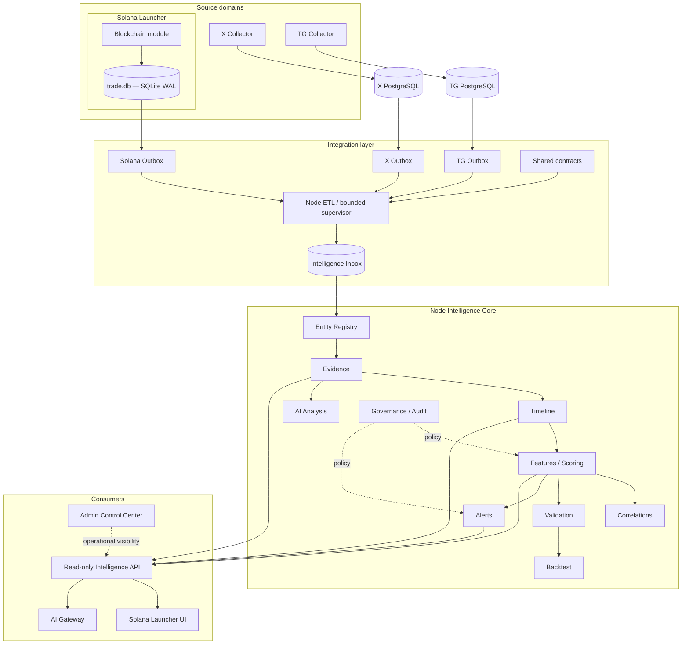

# Целевая архитектура Claude Project — Solana-only (Target)

> Целевое решение от 2026-11-01. Фактическое состояние см. [ARCHITECTURE_AS_IS_20261101.md](ARCHITECTURE_AS_IS_20261101.md).  
> Этот документ задаёт направление развития. Он **не утверждает**, что все целевые runtime уже реализованы или развёрнуты.

## 1. Непереговорные решения

1. **Единственная поддерживаемая blockchain-сеть — Solana.**
2. Canonical token identity: `solana:<full-base58-mint>`. Адресная синтаксическая проверка не доказывает, что адрес является SPL mint.
3. Ethereum, Base, Arbitrum, Bitcoin и прочие сети не входят в целевую архитектуру.
4. X и Telegram — социальные источники evidence, а не blockchain networks.
5. X Collector и TG Collector сохраняют собственные исходные БД, миграции, очереди и lifecycle.
6. Blockchain Collector сейчас — логический модуль Solana Launcher с собственной SQLite `trade.db`, а не отдельный развёртываемый сервис. В целевой модели это остаётся явно обозначенным модулем; отдельный deployable service не вводится без отдельного ADR и доказанной операционной необходимости.
7. Node Intelligence — центральная межсистемная аналитика X/TG/Solana evidence.
8. Python Intelligence — отдельная система document/provider ingestion и scoring. Она не является вторым именем Node Intelligence.
9. Solana Launcher — продуктовый интерфейс и backend, а не владелец исходных данных X/TG.
10. Admin — контрольный/операционный контур, а не источник аналитической истины.
11. Никаких прямых межсервисных SQL-записей в чужие source tables. Передача — через versioned contracts и transactional outbox/inbox.
12. Никаких утверждений об exactly-once: доставка at-least-once, дедупликация и replay — обязательны.

## 2. Целевая логическая схема



Эта схема — target topology. До включения live Outbox флагов и непрерывного Node ETL требуется пройти соответствующие operator gates.

## 3. Источники и ответственность

| Домен | Ответственность | Владелец исходных данных | Хранилище |
|---|---|---|---|
| X | Posts, authors, revisions, metrics, X graph | X Collector | Собственная PostgreSQL |
| Telegram | Messages, edits/deletes, channels, forwards, mentions | TG Collector | Собственная PostgreSQL |
| Solana Blockchain | Wallet observations, parsed swap evidence, revisions, RPC provenance | Blockchain module внутри Solana Launcher | `trade.db`, SQLite WAL |
| Cross-source Intelligence | Нормализация, объединение доказательств, timeline, features, alerts | Node Intelligence | Отдельная PostgreSQL |
| Research documents | Web/RSS/GitHub/YouTube documents, scoring, NLP | Python Intelligence | Текущее Compose: SQLite; PostgreSQL backend — отдельный вариант, не текущий Compose |
| Product | User-facing operations and product state | Solana Launcher | Product PostgreSQL |
| Admin | Operator settings, audit, flags, tasks | Admin Control Center | Admin PostgreSQL |

Ни один потребитель не становится владельцем исходных сообщений, публикаций или сырых blockchain observations.

## 4. Контракты идентичности и evidence

### 4.1 Solana-only token identity

- Единственный chain prefix: `solana:`.
- Полный Solana public key, Base58, 32 decoded bytes, case-sensitive.
- Не использовать ticker, имя, Telegram username или X handle как token primary key.
- Не превращать произвольный Base58 адрес в verified mint.
- X/TG token link допускается только после независимой SPL Token / Token-2022 mint account проверки и фиксации точного evidence.
- Blockchain swap revision — отдельный тип evidence; он не доказывает settled trade, финальность, отсутствие reorg или реализованный PnL.

### 4.2 Social identity

- X author: стабильный numeric ID.
- X source: стабильный numeric account ID.
- TG author/source: стабильный numeric Telegram ID / peer ID.
- Mutable handles и usernames — lookup attributes, не canonical identity.

### 4.3 Время и происхождение

Каждое evidence должно различать:
- `occurredAt` — время события у источника;
- `observedAt` — время получения/наблюдения;
- `knownAt` / `insertedAt` — время доступности в целевой системе;
- `parserVersion` / `schemaVersion` — происхождение интерпретации.

Backtest и as-of queries не должны использовать данные, которые ещё не были известны на момент оценки.

## 5. Integration layer

```mermaid
sequenceDiagram
  participant S as Source DB
  participant O as Source Outbox
  participant E as Node ETL
  participant I as Intelligence PostgreSQL
  S->>O: source row + event in one transaction
  Note over S,O: COMMIT
  E->>O: claim with lease/fencing
  O-->>E: versioned event
  E->>I: inbox + registry + evidence + timeline
  I-->>E: COMMIT
  E->>O: ACK after destination commit
  Note over E,I: replay is safe; duplicate key is checked
```

Требования:
- Outbox event создаётся в той же транзакции, что и source row.
- Consumer claims ограничены lease и fencing token.
- Destination Inbox имеет уникальный ключ `(source_system,event_kind,event_key)`.
- Source ACK — только после destination COMMIT.
- Повторная доставка не меняет итог.
- Один event key с иным schema/evidence/payload должен завершаться collision error, а не молча считаться duplicate.
- Deletes/edits/retractions должны иметь версионное представление.
- Backfill — checkpointed, dry-run-first, с честной coverage метрикой.
- Источники могут быть выключены независимо; source feature flags остаются opt-in до operator approval.

## 6. Node Intelligence Core

Целевая структура:

| Модуль | Назначение |
|---|---|
| Identity / Entity Registry | Канонические Solana mint, wallet, X author, TG source |
| Evidence | Неизменяемые ссылки на первичные наблюдения |
| Inbox / ETL | Доставка, дедупликация, replay, leases, DLQ |
| Timeline | Временная последовательность cross-source событий |
| Features / Scoring | Версионированные признаки и агрегаты |
| Correlations | Связи и синхронность без выдумывания причинности |
| Validation | Coverage, freshness, provenance, missing/unknown |
| Backtest | Chronological, as-of, holdout evaluation |
| Alerts | Кандидаты уведомлений с доказательствами и policy |
| AI Analysis | Интерпретация ограниченного read model, не source of truth |
| Governance / Audit | Policy versions, approvals, audit trail |

Alerts, Validation, Backtest и AI Analysis не теряются внутри абстрактного блока Features/Governance: это самостоятельные модули с разными входами и критериями готовности.

## 7. Python Intelligence — отдельная граница

Python Intelligence отвечает только за исследовательские документы и provider ingestion:
- GitHub / Web / RSS / YouTube providers;
- raw → normalized → derived documents;
- scoring / sentiment / risk;
- отдельные job semantics и storage backends.

Он не читает напрямую X/TG/Blockchain source tables для cross-source token timeline и не ACK-ает их Outbox.

Current deployment fact: Admin Compose запускает Python worker на SQLite volume. PostgreSQL backend в Python codebase — поддерживаемая реализация, но не выбранный backend текущего Compose. Node Intelligence не должен запускаться через Python Dockerfile.

## 8. Product и административные границы

- Solana Launcher — пользовательский frontend/backend, product PostgreSQL, Redis, RabbitMQ, Celery.
- Blockchain module остаётся частью Launcher до отдельного архитектурного решения.
- SolSub — отдельная система подписок; единым владельцем подписок станет только после согласованной миграции всех consumers.
- Memecoin Intelligence остаётся отдельным приложением, пока не принято решение о переносе конкретных функций.
- Telegram MiniApp demo/legacy подпроекты не становятся альтернативным production identity/payment system.
- Admin Control Center управляет операционным состоянием и аудитом; не имеет права обходить владельцев source DB.
- Browser не получает source DB DSN, RPC secrets, X cookies, Telegram sessions или Intelligence API tokens.

## 9. PostgreSQL roles и recovery target

Для каждой PostgreSQL instance после отдельного аудита:
- Bootstrap DBA — initial setup / break-glass only.
- Migration login — DDL и schema ownership в согласованном scope.
- Runtime login — минимально необходимый DML.
- Backup login — read-only backup permissions.

Эти роли должны быть созданы и проверены отдельно для Product, Admin, X, TG, Node Intelligence, Memecoin и SolSub там, где они действительно развёрнуты. Нельзя считать одну synthetic CI rehearsal доказательством cutover всех БД.

Recovery target:
- backup coverage per database/volume;
- encrypted off-host copy;
- independently held integrity proof;
- isolated restore rehearsal;
- sample/schema/sequence assertions;
- measured RPO/RTO;
- primary and backup operator;
- alert receiver and documented rollback.

## 10. Solana-only cleanup — безопасная последовательность

Legacy EVM/Bitcoin compatibility code обнаружен в As-Is. Удалять его одномоментно нельзя.

1. Запретить новые EVM/Bitcoin token/evidence events в source producers и API.
2. Оставить исторические строки как legacy evidence; исключить их из Solana token registry и новых агрегатов.
3. Убрать multi-chain варианты из canonical contract и валидаторов только после проверки всех импортеров и потребителей.
4. Добавить additive SQL migrations для TG legacy EVM edge visibility/write policy; не изменять applied migrations.
5. Удалить EVM/Bitcoin tests только вместе с заменяющими Solana-only regression tests.
6. Удалить KOL Ethereum path, generic X chain-ingest branches и dataset EVM extraction после подтверждения отсутствия production callers.
7. Отключить/удалить cross-chain bridge stubs в wallet-warmup; не оставлять неявно активный multi-chain action.
8. Пересобрать contracts, source producer tests, Intelligence validation, UI types и docs.
9. Пройти CI и проверить, что новые события принимают только Solana, а исторические legacy rows не теряются.

## 11. Этапы реализации

| Порядок | Работа | Критерий приёмки |
|---|---|---|
| P0.1 | Main branch protection | Required checks и запрет force-push реально включены администратором |
| P0.2 | Launcher Node runtime | Docker image использует поддерживаемую LTS; build/health tests зелёные |
| P0.3 | PostgreSQL role cutover | Реальные grants/owners проверены на восстановленной копии; forward/rollback rehearsal |
| P0.4 | Disaster recovery | Настоящая encrypted off-host копия восстановлена; RPO/RTO измерены |
| P1.1 | Solana-only contracts | Только Solana token/chain evidence принимается новыми API/ETL |
| P1.2 | Legacy network cleanup | EVM/Bitcoin writes остановлены, legacy rows сохранены, migrations и UI tests зелёные |
| P1.3 | Node Intelligence supervisor | bounded start/stop, restart, lease renewal, lag/backpressure, DLQ и alerting |
| P1.4 | Source live opt-in | Operator-approved small batch, source coverage, replay, retraction и parity evidence |
| P1.5 | MiniApp docs and service map | README соответствует реальным подпроектам и SQLite provider |
| P2.1 | Unified token timeline UI | Authenticated read-only API, provenance и as-of filters |
| P2.2 | Signal validation | Holdout, leakage controls, calibration, uncertainty и reproducible backtest |

## 12. Что не делать

- Не создавать Ethereum/Base/Arbitrum/Bitcoin collectors.
- Не создавать Kafka/RabbitMQ для Outbox только ради абстракции: текущая source DB + Outbox модель достаточна до измерения bottleneck.
- Не объединять все базы в один PostgreSQL.
- Не превращать Node и Python Intelligence в один runtime.
- Не объявлять Blockchain отдельным service пока он живёт в Launcher.
- Не запускать live RPC, X/TG sessions, миграции, trading или production deploy из документационного PR.
- Не удалять исторические данные при Solana-only cleanup.
- Не объявлять CI PASS доказательством production readiness.

## 13. Связанные документы

- [Фактическое состояние As-Is](ARCHITECTURE_AS_IS_20261101.md)
- [DB ownership](../DB_OWNERSHIP.md)
- [Data contracts](DATA_CONTRACTS.md)
- [PostgreSQL role separation plan](../operations/POSTGRES_ROLE_SEPARATION_PLAN.md)
- [Live tests register](LIVE_TESTS.md)
- [Known gaps](KNOWN_GAPS.md)
