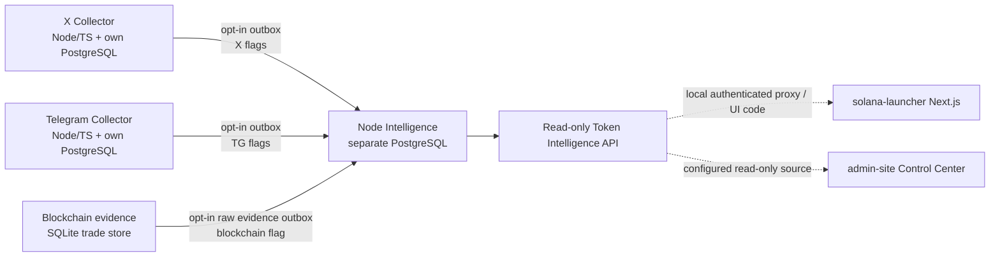
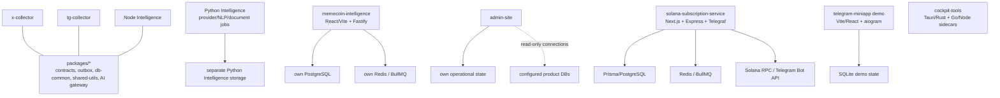

# System dependency map — 2026-10-30

The diagram represents code-level ownership and integration contracts found in the repository. It does **not** assert that any arrow is currently enabled in a live environment.

## Source-to-Intelligence flow

### Source details

- **X:** `x-collector` owns its PostgreSQL records and explicit migration manifest. Its source outbox is opt-in. `scripts/verify-x-token-links.ts` is a separate bounded mint-verification CLI; execution requires `--execute`, configured Alchemy RPC and explicit source/outbox/token-link flags. The normal collector does not silently turn text matches into verified mint claims.
- **Telegram:** `tg-collector` owns its PostgreSQL records and migration ledger. GramJS/MTProto collection is separate from its Alchemy-backed mint resolver. The resolver requires both `TG_INTELLIGENCE_OUTBOX_ENABLED=true` and `TG_INTELLIGENCE_TOKEN_LINKS_ENABLED=true`; source text must contain the exact mint and the RPC account must pass SPL/Token-2022 mint validation.
- **Blockchain:** `solana-launcher` stores chain seed/evidence data in SQLite. The inspected Intelligence outbox emits raw wallet-target evidence. It does not by itself prove token attribution, swap completeness, owner attribution or PnL.
- **Node Intelligence:** source connections are read from X/TG PostgreSQL and blockchain SQLite; destination registry/timeline/token-link/feature data lives in a separate PostgreSQL. `etl:once` is bounded; `etl:supervise` runs a foreground local supervisor only with explicit opt-ins and verified schemas. It never starts collectors or applies migrations.

## Other independent runtime boundaries

- The Python provider/NLP Intelligence code under `intelligence/` is not the Node event-inbox/timeline runtime and must not share assumptions about its DB schema or process lifecycle.
- `memecoin-intelligence` is a standalone product with its own PostgreSQL/Redis/BullMQ stack; it is not the Node Intelligence destination.
- `admin-site` has its own operational state and is designed to open configured product sources read-only. Do not infer that every source is configured.
- `solana-subscription-service` owns subscription/payment/auth state. `telegram-miniapp` is a separate demo/legacy product.
- Shared packages are opt-in building blocks. `packages/db-common` must not replace X Collector's historical migration manifest; `packages/event-outbox` alone does not activate collectors.

## Operational dependencies and safety

| Component | Required local dependencies | Sensitive boundary |
| --- | --- | --- |
| X Collector | Node 22+, dedicated PostgreSQL, encrypted session key, authorized X account/session where applicable | X session and MASTER_KEY; keep outside Git |
| TG Collector | Node 22+, dedicated PostgreSQL, MTProto session and Telegram API credentials | Session/2FA and Telegram API credentials; keep outside Git |
| Blockchain evidence | Node runtime, SQLite WAL-aware store, optional approved Alchemy/Helius RPC | RPC provider credentials and evidence freshness |
| Node Intelligence | Node 22+, separate destination PostgreSQL, read-only source connections, existing source outbox schemas | Separate destination writer vs source read roles; no migration is run by the supervisor |
| Python Intelligence | Python runtime, provider configuration and its own storage | Provider API keys and document/source access |
| Memecoin Intelligence | Node runtime, PostgreSQL, Redis, optional Qwen service | Product database, Redis and optional inference provider |
| Admin Control Center | Python runtime, own state DB and configured read-only source connections | Admin session/password and source read-only credentials |
| Subscription service | Node runtime, PostgreSQL, Redis, Solana RPC and Telegram Bot API | Wallet/payment verification and subscription secrets |

## Shared-package edges

- `packages/contracts`: canonical IDs, event/evidence/token-link schemas; syntax validation is not on-chain proof.
- `packages/event-outbox`: PostgreSQL/SQLite at-least-once primitives; same-transaction source integration remains caller responsibility.
- `packages/db-common`: explicit caller-owned migration helpers; do not apply blindly to legacy X migrations.
- `packages/shared-utils`: optional retry, redaction, encryption and local quota helpers; not a distributed budget.
- `packages/ai-gateway`: provider/model routing used by Intelligence components; provider credentials remain server-side.

## Verification boundaries

CI tests use disposable PostgreSQL/SQLite fixtures and synthetic data. The following require separate authorization/evidence: real X account access, Telegram MTProto session, paid RPC, actual production DB inventory, source/target migration status, backup restore, live outbox delivery, and a complete three-source verified token timeline.
